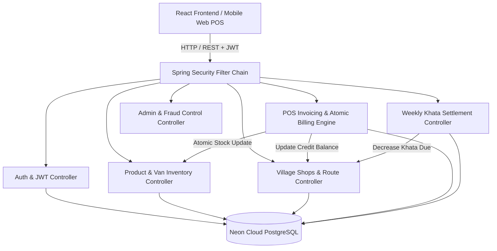

# VanSales Khata - B2B FMCG Van Distribution & Digital Ledger System

[](https://spring.io/projects/spring-boot)
[](https://www.oracle.com/java/)
[](https://reactjs.org/)
[](https://neon.tech/)
[](https://tailwindcss.com/)

A real-time, multi-tenant B2B wholesale distribution platform and digital credit ledger (Khata) built for FMCG van sales distributors delivering goods directly to rural retail village shops.

---

## Key Features

- **Multi-Tenant Data Isolation:** Each distributor operates their own private catalog, village shops, routes, van stock inventory, and digital ledgers.
- **Dual-Unit FMCG Packaging Math:** Seamless calculation and conversion between wholesale bulk boxes and loose dozens (`Total Dozens = (Boxes × DozensPerBox) + LooseDozens`).
- **Quick POS Billing Terminal:** On-the-spot invoicing with atomic inventory deduction, instant partial cash/UPI payments, and automated Khata balance tracking.
- **Digital Khata Passbook:** Real-time ledger statement detailing past invoices, running balance dues, and repayment logs for every village shop.
- **Role-Based Access Control (RBAC):**
  - `ROLE_SELLER` (Van Distributor / Driver): Catalog management, stock reloads, POS billing, cash collection.
  - `ROLE_BUYER` (Village Retail Shopkeeper): Wholesale catalog browsing, pre-orders, digital passbook inspection.
  - `ROLE_ADMIN` (System Security & Fraud Control): User audits, system financial health metrics, and fraud user purge.
- **Persistent Cloud Database:** Powered by Neon PostgreSQL with Spring Data JPA and automated DDL schema migrations.

---

## Tech Stack

### Backend
- **Framework:** Spring Boot 3.3.3 (Java 21)
- **Security:** Spring Security 6 with stateless JWT authentication & bcrypt password encoding
- **Persistence:** Spring Data JPA / Hibernate with Neon Cloud PostgreSQL
- **Architecture:** Controller -> Service -> Repository layered architecture
- **Validation:** Jakarta Bean Validation (`@Valid`, `@NotNull`, `@Min`)
- **Testing:** JUnit 5 & Spring Boot Test

### Frontend
- **Framework:** React 18 with Vite
- **Styling:** Tailwind CSS with responsive layout & Lucide Icons
- **State & Networking:** React Context API (`AuthContext`) & Axios with JWT interceptors

---

## Architecture Diagram



---

## Getting Started

### Prerequisites
- **JDK 21+**
- **Node.js 18+ & npm**
- **Maven 3.8+**

### 1. Run Backend
```bash
cd backend
mvn spring-boot:run
```
Backend starts on `http://localhost:8080`.

### 2. Run Frontend
```bash
cd frontend
npm install
npm run dev
```
Frontend runs on `http://localhost:5173`.

---

## API Endpoints Overview

| Method | Endpoint | Description | Access |
| :--- | :--- | :--- | :--- |
| `POST` | `/api/auth/register` | Register distributor, shop, or admin | Public |
| `POST` | `/api/auth/login` | Phone + PIN login with JWT generation | Public |
| `GET` | `/api/products` | Get isolated product catalog | Authenticated |
| `POST` | `/api/products` | Create product SKU with dual packaging | `ROLE_SELLER` |
| `POST` | `/api/products/adjust-stock` | Load or adjust van stock | `ROLE_SELLER` |
| `GET` | `/api/shops` | Get distributor's village shops | `ROLE_SELLER` |
| `POST` | `/api/shops` | Onboard new village retail store | `ROLE_SELLER` |
| `GET` | `/api/shops/{id}/statement` | Get full digital Khata ledger statement | Authenticated |
| `POST` | `/api/billing` | Create atomic on-the-spot invoice | `ROLE_SELLER` |
| `POST` | `/api/payments/settle` | Record weekly cash/UPI Khata repayment | `ROLE_SELLER` |
| `GET` | `/api/admin/users` | List all users for fraud audit | `ROLE_ADMIN` |
| `DELETE`| `/api/admin/users/{id}` | Permanently purge fraudulent user | `ROLE_ADMIN` |

---

## License
MIT License
